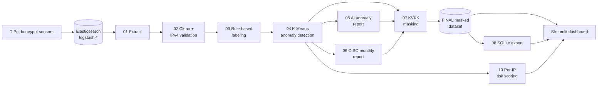

# Agentic AI in Threat Intelligence: Autonomous Multi-Vector Honeypot Analysis

An end-to-end threat-intelligence pipeline that turns raw T-Pot honeypot logs into labeled, risk-scored, KVKK-compliant intelligence, with LLM-generated analyst and executive reports and an interactive Streamlit dashboard.

---

## Architecture



### Pipeline stages

| Stage | Script | What it does | Output |
|---|---|---|---|
| 01 | `01_data_extraction.py` | Pulls 30 days of events from Elasticsearch (`ES_HOST` / `ES_INDEX`, optional basic auth) using the scroll API | `01_tpot_raw_data_30days.parquet` |
| 02 | `02_preprocessing_and_eda.py` | Removes noise sensors (Suricata, P0f), validates `src_ip`, keeps the relevant columns, draws EDA plots | `02_tpot_filtered_data.parquet` |
| 03 | `03_rule_engine.py` | Labels attacks: `Malware_Dropper` (incl. URL- and Base64-obfuscated commands), `Database_ERP_BruteForce`, `Web_Exploit_Attempt`, `Encrypted_Traffic_Profile`, `Uncategorized` | `03_tpot_labeled_data.parquet` |
| 04 | `04_ml_anomaly.py` | K-Means clustering (payload length, inter-arrival time, target port) on uncategorized traffic; flags the outlier cluster as `ML_Detected_Anomaly` | `04_tpot_30days_final_labeled.parquet` |
| 05 | `05_ai_agent.py` | LangGraph ReAct agent (Groq LLM) enriches an anomaly via AbuseIPDB and VirusTotal tools and writes a technical threat report | `ai_reports/anomaly_report_01.txt` |
| 06 | `06_executive_reporter.py` | Aggregates 30-day statistics and writes a monthly executive (CISO) report | `ai_reports/monthly_executive_report.txt` |
| 07 | `07_kvkk_compliance.py` | Masks every IP in the dataset and in the generated reports | `FINAL_tpot_30days_kvkk_compliant.parquet` |
| 08 | `08_export_to_db.py` | Exports the masked dataset and reports to SQLite | `threat_intel.db` |
| 09 | `09_generate_visuals.py` | Attack-type distribution chart | `report_visuals/` |
| 10 | `10_risk_scoring.py` | Computes a 0–100 risk score per attacker IP | `10_ip_risk_scores.parquet` |

---

## Features

- **Streamlit dashboard** with six tabs: overview, geographic map, risk scores, ports & sensors, executive report, raw data. It uses a dark theme and sidebar filters for sensor, attack type and date range.
- **On-demand AI drill-down reports:** pick an IP in the risk tab and generate a threat report for it with the same agent as stage 05. Reports are cached in the session and in SQLite, and the model output is masked before it is shown or stored.
- **Monthly CISO report** in the dashboard. It can be regenerated, warns when the model hit its token limit, and can be exported as a compact, Unicode-safe PDF.
- **Per-IP risk scoring.** A weighted score combines:
  - AbuseIPDB confidence (50%)
  - VirusTotal detection ratio (30%)
  - the ML anomaly flag (20%)

  A signal that can't be obtained is left out and the remaining weights are renormalized, so missing data never makes an IP look clean.
- **Live system-status badge** with two checks: the number of running T-Pot containers, and how recently the last event reached Elasticsearch. It reports Live, Degraded, Down or Unknown. "Unknown" (the services could not be reached) is kept separate from "Down" (confirmed failure).
- **KVKK-compliant IP masking** throughout. See [Privacy & KVKK](#privacy--kvkk).
- **`src_ip` data-quality validation** using the standard library `ipaddress` module. Invalid values are kept and flagged rather than dropped. See [Data quality](#data-quality).

---

## Tech stack

| Area | Tools |
|---|---|
| Data source | T-Pot, Elasticsearch |
| Data processing | Python, pandas, PyArrow |
| Machine learning | scikit-learn (K-Means, StandardScaler) |
| LLM / agents | Groq (`openai/gpt-oss-20b`), LangChain, LangGraph |
| Threat intelligence | AbuseIPDB, VirusTotal |
| Dashboard | Streamlit, Plotly, GeoIP2Fast, pycountry |
| Storage | Parquet, SQLite |
| Reporting | fpdf2 (PDF export), Matplotlib, Seaborn |
| Packaging | Docker, Docker Compose |

---

## Quick Start (Demo)

Run the dashboard with no T-Pot, no Elasticsearch and no API keys, using synthetic demo data:

```bash
docker compose run --rm dashboard python generate_demo_data.py
docker compose up
# -> http://localhost:8501
```

Without Docker:

```bash
pip install -r requirements.txt -c constraints.txt   # Python 3.11
python generate_demo_data.py
streamlit run dashboard.py
```

`generate_demo_data.py` writes every file the dashboard reads, with the same schema as the real pipeline:
- `04_tpot_30days_final_labeled.parquet`
- `FINAL_tpot_30days_kvkk_compliant.parquet`, masked with stage 07's own code
- `10_ip_risk_scores.parquet`, scored with stage 10's own formula
- `threat_intel.db`

The data covers about 24,000 events across 12 honeypot sensors over 30 days. It includes database brute force, TLS profiling, web exploit attempts, an ADB malware dropper, an ML-flagged Elasticsearch injection, and a few invalid `src_ip` rows. Pre-written AI reports are included for every risk block and for the monthly CISO report.

- **Synthetic only.** IP addresses come only from the RFC 5737 documentation ranges (`192.0.2.0/24`, `198.51.100.0/24`, `203.0.113.0/24`), and nothing is derived from real data. A fixed seed makes every run identical.
- **No API keys needed.** All tabs, the cached drill-down reports and the PDF export work offline. Buttons that would call the LLM ("Rapor Üret" on a report that isn't cached, "Yeniden Üret") show a warning until `GROQ_API_KEY` is set.
- **Your data is safe.** If any output already holds non-demo data, the script stops without changing anything. With `--force`, it first moves those files to `real_data_backup/<timestamp>/` (git-ignored); it never deletes them.
- **What masking does to the demo.** The dashboard masks IPs to their first two octets, so the three documentation ranges appear as just three masked blocks (`192.0.***.***`, `198.51.***.***`, `203.0.***.***`), plus the invalid-IP bucket. GeoIP only resolves one of those blocks, so the map shows a single country.
- **Generate first.** If the dashboard is already running when you generate data, restart it, because Streamlit caches loaded data.

---

## Getting started

### 1. Configure

```bash
cp .env.example .env
# then fill in GROQ_API_KEY, ABUSEIPDB_API_KEY, VT_API_KEY and, optionally, the ES_* values
```

`.env` is optional for the demo: Docker Compose starts without it.

### 2a. Run with Docker

The image contains code only. Data files stay on the host and are mounted into the container (`.:/app`), so the dashboard and pipeline read and write them in the project folder.

```bash
# Build and start the dashboard -> http://localhost:8501
docker compose up -d --build

# Run pipeline stages in the same image
docker compose run --rm dashboard python 01_data_extraction.py
docker compose run --rm dashboard python 02_preprocessing_and_eda.py
docker compose run --rm dashboard python 03_rule_engine.py
# ... and so on through 10
```

Notes:
- **Reproducible builds.** The image installs dependencies with `pip install -r requirements.txt -c constraints.txt`. `requirements.txt` lists the direct dependencies; `constraints.txt` is a lock file that pins the entire transitive tree (91 packages, including the Streamlit server stack and LangChain's dependencies), so every build installs the same verified versions. It was generated on Python 3.11, the image's Python, and resolves identically on Linux amd64 and arm64.
- **Updating dependencies:** change `requirements.txt`, install it into a fresh Python 3.11 venv, verify the app, then regenerate the lock with `pip freeze > constraints.txt` (keep the header comment).
- **Elasticsearch from inside the container:** `localhost` refers to the container itself. For an Elasticsearch running on the host, set `ES_HOST=http://host.docker.internal:9200` in `.env`. Stage 01 and the status badge both use it. Compose maps `host.docker.internal` to the host, including on Linux.
- **Status badge, container check:** this needs the Docker CLI, which isn't in the image, so inside the container the badge shows that check as unreachable.
- If Elasticsearch can't be reached, stage 01 stops with a clear message and points to the demo mode.

### 2b. Run locally

Use Python 3.11, the same as the Docker image; the lock file is verified for it.

```bash
python -m venv .venv
source .venv/bin/activate        # Windows: .venv\Scripts\activate
pip install -r requirements.txt -c constraints.txt

# Pipeline, in order
python 01_data_extraction.py
python 02_preprocessing_and_eda.py
python 03_rule_engine.py
python 04_ml_anomaly.py
python 05_ai_agent.py
python 06_executive_reporter.py
python 07_kvkk_compliance.py     # after 05/06: also masks their reports
python 08_export_to_db.py        # after 07: exports masked data only
python 09_generate_visuals.py
python 10_risk_scoring.py        # any time after 04; populates the risk tab

# Dashboard
streamlit run dashboard.py
```

---

## Configuration

All settings come from `.env` (see `.env.example`). Nothing is hardcoded, and empty values fall back to the defaults below.

| Variable | Used by | Purpose |
|---|---|---|
| `GROQ_API_KEY` | 05, 06, dashboard | LLM for the threat and executive reports (the dashboard warns instead of calling the LLM when it's empty) |
| `ABUSEIPDB_API_KEY` | 05, 10 | IP reputation |
| `VT_API_KEY` | 05, 10 | Payload hash reputation |
| `ES_HOST`, `ES_INDEX` | 01, status badge | Elasticsearch location (defaults: `http://localhost:9200`, `logstash-*`) |
| `ES_USER`, `ES_PASSWORD` | 01, status badge | Optional Elasticsearch basic auth, used only when both are set |
| `TPOT_NAME_FILTER` | status badge | Container name filter for T-Pot (default: `tpot`) |

---

## Privacy & KVKK

This project processes attacker IP addresses and follows Turkish data-protection law (KVKK, Law No. 6698) by design:

- **Masking rule.** Every IPv4 address shown or stored downstream keeps only its first two octets: `203.0.113.45` becomes `203.0.***.***`. Stage 07 applies this rule to the dataset (`src_ip`, `src_ip_raw`, `dest_ip`, and IPs inside `payload`, `url` and `downloads`) and to all generated reports.
- **The dashboard shows only masked IPs.** It reads the masked `FINAL` dataset. Where it needs unmasked data internally (to look up the row behind a selected masked IP), only the masked form is ever displayed or written to the database. LLM output is masked again before display or storage, in case the model echoes an address.
- **Real data is never committed.** The unmasked intermediate files (01–04 parquet, `10_ip_risk_scores.parquet`), the SQLite database, generated reports and `.env` are excluded by `.gitignore` and `.dockerignore`. The repository and the Docker image contain code only.
- **External APIs.** Reputation lookups (AbuseIPDB) and the AI reports (Groq) necessarily receive the real IP of the address being analyzed. No other personal data is sent.

---

## Data quality

Honeypots receive hostile input, and some events carry garbage in the source-IP field: empty values, or injected payloads such as `${jndi:ldap://...}` (Log4Shell). Stage 02 validates every `src_ip` as IPv4 with the standard library `ipaddress` module and follows a **flag, don't drop** policy:

- `src_ip_valid` (bool) marks each row.
- Invalid rows get the sentinel `src_ip = "INVALID"`, which masks to `***.***.***.***` and is excluded from IP selection in the dashboard.
- The original value is kept in `src_ip_raw` for forensics, for invalid rows only. Stage 07 masks any IPv4 embedded in it.

---

## Screenshots

> _Placeholders. Add images under `docs/screenshots/`._

| Overview | Risk scores & AI drill-down |
|---|---|
|  |  |

| Geographic map | Executive report |
|---|---|
|  |  |

---

## Project structure

```
├── 01_data_extraction.py … 10_risk_scoring.py   # pipeline stages
├── dashboard.py                                # Streamlit dashboard
├── status_check.py                             # live status checks (Docker + Elasticsearch)
├── generate_demo_data.py                       # synthetic demo data (no T-Pot / API keys needed)
├── assets/logo.png                             # logo (loading screen, page icon)
├── .streamlit/config.toml                      # dashboard theme
├── requirements.txt                            # direct dependencies
├── constraints.txt                             # lock file: full pinned dependency tree
├── Dockerfile
├── docker-compose.yml
└── .env.example
```

---

## Attribution

Built upon [ORIGINAL_REPO_NAME](ORIGINAL_REPO_URL) by ORIGINAL_AUTHOR, extended with the author's permission.
